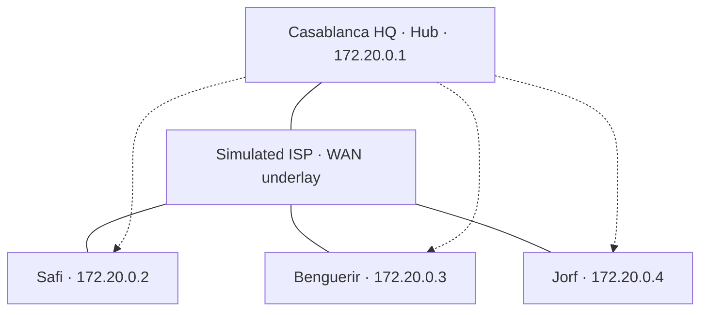

# GNS3 DMVPN and OSPF Lab

This Cisco IOS lab models a Casablanca headquarters and three branches across a simulated ISP. It explores how a multipoint GRE overlay uses NHRP to locate peers, IPsec to protect tunnels, and OSPF area 0 to exchange routes. The project also retains some earlier point-to-point GRE configuration for comparison.

## DMVPN overlay

Dashed lines show `Tunnel100` on `172.20.0.0/24`. Solid lines show WAN links to the simulated ISP, whose address on each WAN subnet ends in `.1`.

| Site | Role | WAN router | Site LAN |
| --- | --- | --- | --- |
| Casablanca | Hub | `10.254.0.10` | `192.168.1.0/24` |
| Safi | Spoke | `10.254.1.10` | `192.168.2.0/24` |
| Benguerir | Spoke | `10.254.2.10` | `192.168.3.0/24` |
| Jorf | Spoke | `10.254.3.10` | `192.168.4.0/24` |

The original WAN addresses were remapped to private lab subnets. The older diagram showed the Casablanca–Safi point-to-point GRE link. The diagram above shows the DMVPN overlay in the saved configs.

## Reproduce in GNS3

1. Copy the project to a scratch GNS3 folder and open `DMVPN-OSPF.gns3` with its `project-files` folder alongside it. The project was saved in GNS3 `2.2.59` and uses five local Cisco 3725 Dynamips nodes. Supply your own compatible Cisco IOS image.
2. Keep the topology isolated. The published startup configurations have no shared keys. Set matching lab-only IKE keys for the peers you want to test, and use matching NHRP authentication values across the overlay if you enable NHRP authentication. Keep the resulting running configs and keys outside the public checkout.
3. Verify the ISP underlay reaches each peer. Then use `show dmvpn`, `show ip nhrp`, `show crypto ipsec sa`, `show ip ospf neighbor`, and `show ip route ospf` to check the tunnel and routing layers separately.

## Status and troubleshooting

- The saved topology and startup configs passed structural checks. This sanitized copy has not been booted in GNS3.
- A saved Benguerir configuration has a LAN interface on `192.168.3.0/24` but no matching OSPF network statement. Check its advertisement from Casablanca before testing LAN-to-LAN traffic.
- Benguerir and Jorf retain OSPF statements for older GRE subnets without matching point-to-point interfaces in this snapshot. Test `Tunnel100` separately from those older GRE entries.

The repository contains the GNS3 project and sanitized startup configs. Cisco images, emulator state, and logs are excluded.
